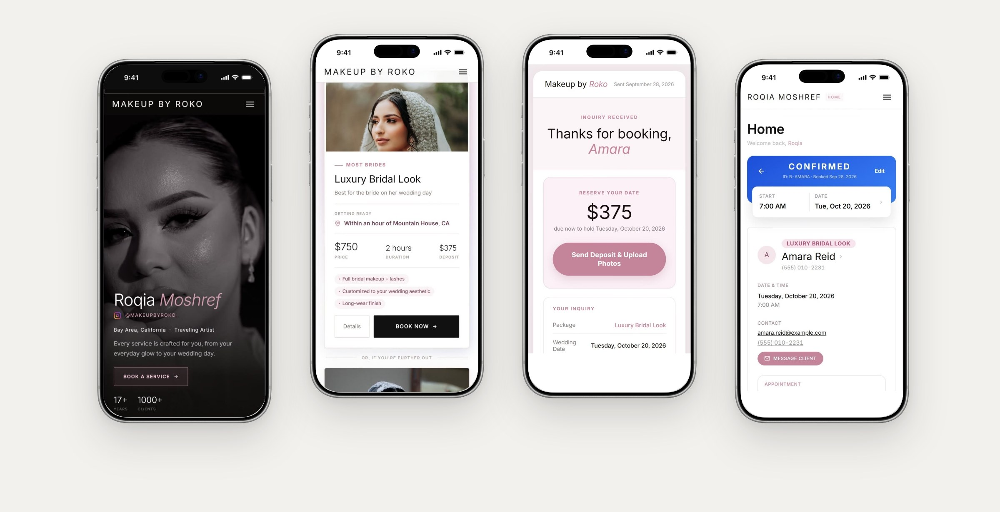
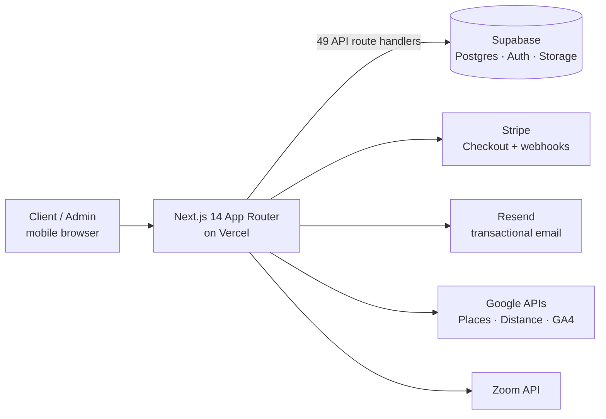

<div align="center">

# Makeup by Roko

**A full-stack booking, deposit and admin platform for a bridal makeup artist with 185K followers.**

[**makeupbyroko.org**](https://makeupbyroko.org) &nbsp;·&nbsp; Built solo by [Faizan Tariq](https://github.com/faizant316)




</div>

## The problem

Every booking used to happen in Instagram DMs. Clients couldn't see which dates were open, prices and deposits were explained one message at a time, and every booking was tracked and confirmed by hand.

## What it does

**For clients**

- Browse services with pricing and deposit shown upfront
- Pick from a live availability calendar (only open dates can be selected)
- Review and e-sign the service agreement in the app
- Get a confirmation email with a secure, token-based deposit link
- Send the deposit on Zelle and upload the screenshot to a private storage bucket
- Buy makeup class tickets through Stripe Checkout

**For the business owner**

- Mobile-first admin dashboard: new requests land as *pending*, one tap confirms and emails the client
- Calendar management: block off dates and time, set daily capacity
- Client profiles, private notes and booking history
- Zoom consultation scheduling, travel-distance lookup and review moderation
- Live traffic dashboard via the Google Analytics Data API

## Architecture



## By the numbers

| | |
|---|---|
| API route handlers | 49 |
| Database migrations | 23 |
| Commits | 550+ (May 2026 → today) |
| Lighthouse (desktop) | Performance 95 · Accessibility 92 · Best Practices 96 · SEO 100 |

## Tech stack

| Layer | Tools |
|---|---|
| Frontend | Next.js 14 (App Router), React, Tailwind CSS, TanStack Query |
| Backend | Next.js route handlers, Supabase (PostgreSQL, Auth, Storage) |
| Payments | Stripe Checkout + webhooks (class tickets), Zelle with screenshot verification |
| Email | Resend (transactional email + delivery webhooks) |
| Integrations | Google Places & Distance Matrix, GA4 Data API, Zoom |
| Hosting | Vercel (deploys, cron health check) |

## Project structure

```
app/            Next.js routes: pages, admin, and /api route handlers
src/components  UI components (booking flow, calendar, contract signing, gallery)
src/lib         Business logic: pricing, contracts, email templates
supabase/       Schema, seed data and SQL migrations
scripts/        Database and QA scripts
```

## Running locally

```bash
npm install
cp .env.example .env.local   # fill in your own keys
npm run dev
```

## Timeline

| | |
|---|---|
| April 2026 | Discovery with the client: how she books, prices and takes deposits |
| May – July 2026 | Design and build (10 weeks, 400+ commits) |
| July 2026 | Launched at makeupbyroko.org |
| Ongoing | Maintenance and new features |

---

<div align="center">

Built by **Faizan Tariq** · [GitHub](https://github.com/faizant316) · [fzydev.com](https://fzydev.com)

</div>
